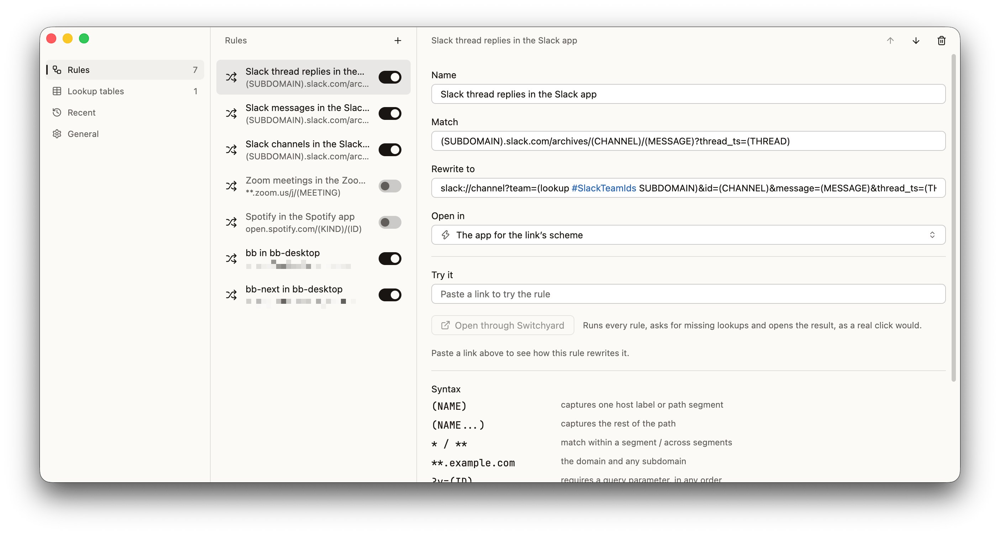

# Switchyard

A default web browser for macOS that doesn't show web pages. It routes every link you click to the right place:
Slack links open in Slack, meeting links open in Zoom, work links open in your work browser, and everything
else goes to your usual browser.



## Install

You need Rust 1.95 or newer.

```sh
./scripts/bundle.sh
```

This builds `Switchyard.app`, installs it in `~/Applications` and registers it with macOS. Open it and choose
**General → Make default**, or pick it under System Settings → Desktop & Dock → Default web browser.

Switchyard lives in the menu bar. Choose **Settings…** there to edit rules, or open the app again.

## Rules

Rules are checked from top to bottom, and the first one that matches decides where the link goes. Each rule
has a match pattern and either a browser or a rewrite. They're stored in
`~/Library/Application Support/Switchyard/config.toml`, and you can edit them in Settings or by hand.

```toml
browser = "company.thebrowser.dia"   # where links go when no rule matches
picker_modifier = "option"           # hold it while clicking to choose a browser
strip_tracking = true                # drop utm_* and similar parameters

[[rules]]
name = "Slack channels in the Slack app"
match = "(SUBDOMAIN).slack.com/archives/(CHANNEL)/**"
rewrite = "slack://channel?team=(lookup #SlackTeamIds SUBDOMAIN)&id=(CHANNEL)"
```

### Match patterns

- `scheme://` is optional. Without it a pattern matches `http` and `https`, and `*://` matches any scheme.
- `(NAME)` captures one host label or path segment. `(NAME...)` captures the rest, slashes included.
- `*` matches within one label or segment, and `**` matches across them. A leading `**.` matches any number
  of subdomains, including none.
- A pattern with no path matches every path. With a path, the whole path has to match.
- `?key=(VALUE)` requires that query parameter, in any order. `#(FRAGMENT)` does the same for the fragment.

### Rewrite templates

Text outside parentheses is copied as is. Inside parentheses you can use:

- `(NAME)`: a capture, or one of `url`, `scheme`, `host`, `path`, `query`, `fragment`.
- `(lookup #Table KEY)`: a value from a lookup table in `lookups.toml`. If the value is missing, Switchyard
  asks you for it the first time and remembers your answer.
- `encode`, `decode`, `lower`, `upper`, `or A B …`, `query "param"`, `replace X "from" "to"`.

Try a rule without clicking anything:

```sh
~/Applications/Switchyard.app/Contents/MacOS/switchyard test "https://acme.slack.com/archives/C0123ABCDEF"
```

## Browser extension

A browser only asks its default browser about links you click in other apps. Links clicked inside the
browser itself never reach Switchyard. The extension in `extension/` closes that gap for Chromium browsers
(Chrome, Arc, Dia, Edge, Brave, Vivaldi, Opera, Comet, Helium and others): it sends matching links to
Switchyard and leaves all other links alone.

To set it up, open **Settings → General → Browser extension** and click **Set up** next to a browser.
Switchyard then:

- registers itself as the extension's native messaging host,
- copies the extension folder path to your clipboard,
- opens that browser's Extensions page.

On the Extensions page, turn on Developer mode and click **Load unpacked**. Press ⌘⇧G, then ⌘V, then ↩,
and click **Select**.

Safari and Firefox aren't supported.

## Development

```sh
cargo test
cargo run -- test "https://example.com"
```

The UI uses [GPUI](https://www.gpui.rs) and
[Ely GPUI Components](https://git.zacharyzhang.com/ZacharyZhang-NY/Ely-GPUI-Components).

## License

Licensed under either of [Apache License, Version 2.0](LICENSE-APACHE) or [MIT license](LICENSE-MIT), at your
option.
